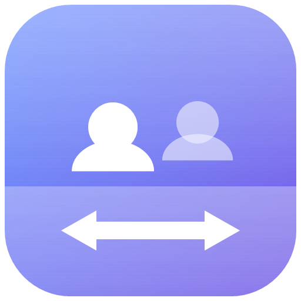

# Cursor 账号切换器

给 Cursor 每个账号开一个独立实例，同时在线、互不干扰。界面用 WebView2 渲染，启动默认直达 **Agent 面板**。



## 它解决什么

Cursor 默认只记一个登录态。想同时用「公司号」和「个人号」，切来切去既丢上下文又得反复登录。

这个工具给每个账号分配独立的 `--user-data-dir`，各自保存登录状态、聊天记录、设置；主账号仍然用 Cursor 自带的默认目录，不受影响。

## 功能

| 功能 | 说明 |
|---|---|
| 多实例并行 | 每个账号一个独立数据目录，可同时运行 |
| 状态识别 | 从 `state.vscdb` 读邮箱与订阅类型，实时显示运行状态 |
| Agent 面板启动 | 默认 `--glass`，启动即进入对话界面；可切换成编辑器窗口 |
| 设置同步 | 把主账号的 `settings.json` / 快捷键 / 片段复制到其他账号，哈希保护防止覆盖你自己的改动 |
| 会话同步 | 白名单同步最近项目、终端历史等 UI 状态，**绝不触碰 `cursorAuth/*` 凭证** |
| 版本选择 | 多份 Cursor 安装时自动选版本最高的那份启动 |
| 打开项目 | 指定用某个账号的实例打开某个文件夹 |

## 安装

需要 [.NET 8 Desktop Runtime](https://dotnet.microsoft.com/download/dotnet/8.0) 和 [WebView2 Runtime](https://developer.microsoft.com/microsoft-edge/webview2/)（Win11 已内置）。

```powershell
git clone <this-repo>
cd CursorAccountSwitcher
dotnet build
dotnet run
```

打包成可直接分发的版本：

```powershell
dotnet publish -c Release -r win-x64 --self-contained false -o dist
```

`dist\CursorAccountSwitcher.exe` 即可运行。

## 使用

1. 打开后会自动列出主账号（Cursor 默认数据目录）
2. 点「添加账号」→ 起个名字 → 立即启动
3. 在新窗口里点右上角头像 → Sign In 登录第二个账号
4. 之后两个账号可以同时开着，用「切换过去」在窗口间跳

数据目录在 `%APPDATA%\CursorAccountSwitcher\profiles\<id>`，每个账号独立。移除账号时可以选择是否连数据一起删。

## 关于 Agent 面板

Cursor 3.x 有两种窗口形态：

- `--glass` → **Agent 面板**（对话优先，启动直接能和 Agent 说话）
- `--classic` → 传统编辑器窗口（VS Code 布局）

切换器默认用 Agent 面板。底部「编辑器模式」开关可以改回传统布局，改完下次启动生效。

## 数据安全

- 凭证只读不写：`StateDbReader` 用 `SqliteOpenMode.ReadOnly` 打开数据库
- 同步白名单：`SessionSync` 只同步 7 个纯 UI 状态键，另有防御性检查拦截含 `auth0` / `oauth2` / `cursorAuth` 的键
- 设置同步有哈希记录：目标账号里被你自己改过的文件会被跳过，不会被主账号版本覆盖
- 启动参数只有 `--user-data-dir` 和窗口模式标志，没有 `--reset` 之类的破坏性开关

## 已知情况

**机器上装了多份 Cursor 时**，早期版本会按「第一个找到的」选 exe，可能选中迁移到其它盘的旧安装。旧版客户端连 `agentn.api5.cursor.sh` 会持续 `Premature close` / TLS 中断，表现为发消息一直失败。

现在 `CursorLocator` 会收集所有安装、按 `ProductVersion` 取最高，副标题里也会提示「另检测到 X，已忽略」。确认选对了再启动。

## 结构

```
UiBridge.cs                 WebView2 与本地服务之间的 JSON 桥
assets/ui/                  index.html / app.css / app.js —— 全部界面
Services/
  CursorLocator.cs          定位 Cursor 安装，多版本时选最新
  AntigravityLocator.cs     定位 Antigravity 2.x（Antigravity.exe）
  CodexLocator.cs           定位 Codex 桌面版（商店版 ChatGPT.exe）
  CursorProcesses.cs        枚举进程、解析 --user-data-dir、判断归属
  InstanceService.cs        启动 / 关闭实例
  WindowActivator.cs        Win32 窗口激活
  StateDbReader.cs          只读 state.vscdb 取 Cursor 登录信息
  AntigravityLoginReader.cs 读 app_storage.json 取 Antigravity 登录名
  CodexLoginReader.cs       解析 auth.json 的 id_token 取 Codex 邮箱与套餐
  CodexInstanceTracker.cs   记录 Codex 副实例 PID（命令行不带数据目录）
  SettingsSync.cs           设置文件同步（哈希保护）
  SessionSync.cs            UI 状态同步（白名单）
  ProfileStore.cs           账号档案 JSON 持久化
  AppPrefs.cs               应用偏好
  AppCatalog.cs             三个应用的路径、进程名与隔离参数
Models/AccountProfile.cs    账号档案模型
Models/AppKind.cs           应用枚举与 JSON 转换
```

## Antigravity 多账号

副账号启动时同时做三件事：窗口数据用独立的 `--user-data-dir`、用户目录指向该账号的沙箱
（对话和登录落在 `<沙箱>\.gemini`）、进程环境里带 `SSH_CONNECTION`，让语言服务把 token
写成该目录下的文件，而不是机器上共享的那条 `gemini:antigravity` 凭据。主账号不改环境，
继续用现有登录。旧版 VS Code 的「Antigravity IDE」与 2.x 独立版路径不同，本工具只支持后者。

## Codex 多账号

Codex 桌面版由 Microsoft Store 分发，会忽略 `--user-data-dir`，窗口状态只能共享。副账号
通过 `CODEX_HOME` 隔离登录、会话与配置，主账号继续用 `~\.codex`。由于它的命令行里不带
数据目录，切换器在启动时记下新出现的进程，用来判断某个副账号是否还在运行；从开始菜单
另开的窗口会被当成主账号。

## License

MIT
